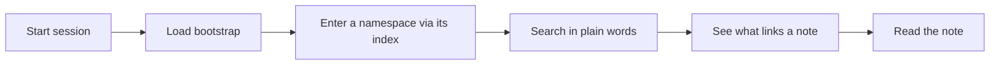
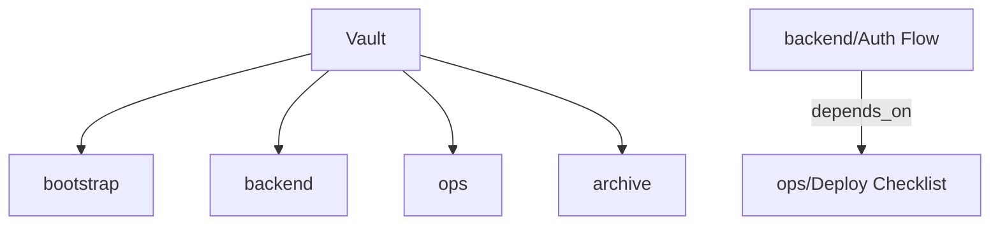
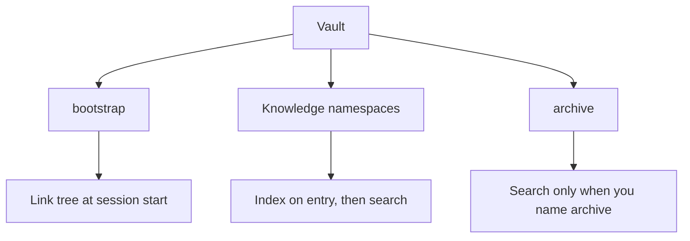
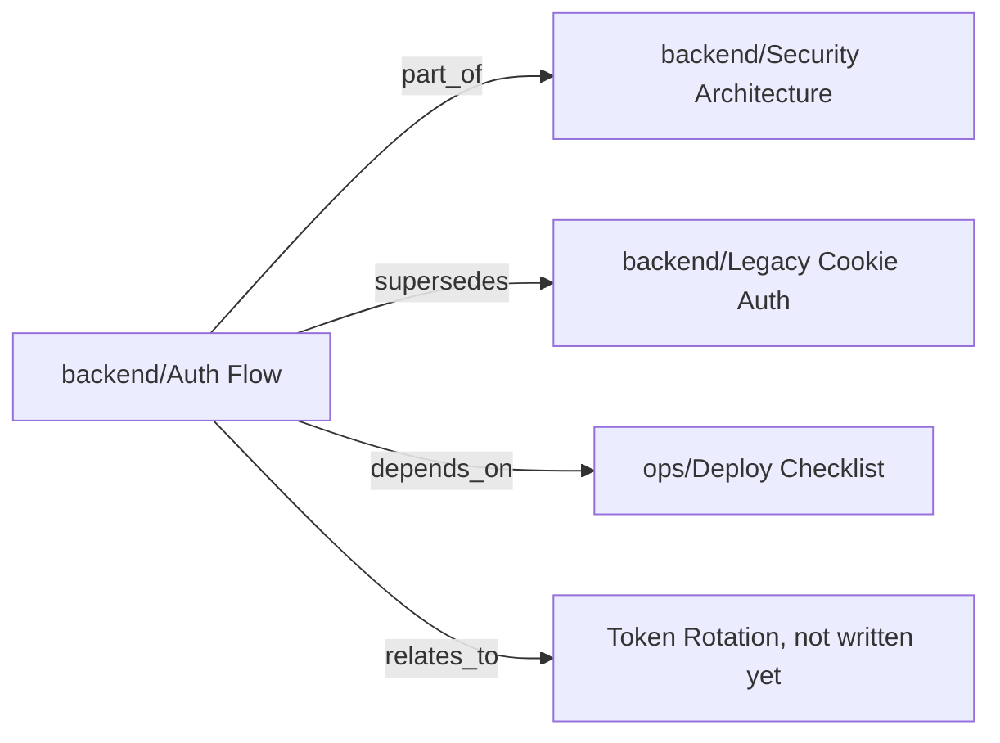

# Recognitor

Recognitor is a local memory for an assistant. You keep ordinary Markdown notes. The assistant loads a short set of instructions at the start of a session, searches the rest, and follows links.

The files on disk are the memory. You open them in any editor. Beside them sits an index that makes search and “what links here” fast. Delete the index and rebuild it; the notes stay.

Work, personal, and research notes share one graph. A work note can link a personal note, and a walk follows that link.

## How a session works



1. **Bootstrap.** At the start, Recognitor loads the notes linked from `bootstrap/index.md`: who you are, how to talk to you, rules that apply everywhere.
2. **Enter a namespace.** A namespace is a top-level folder. Opening it means reading that folder’s `index.md`. The folder is a doorway and a point of view. Search can still find notes in other namespaces.
3. **Search.** Ask in plain words. Notes in the current namespace, and notes it links, rank higher. Other knowledge namespaces can still appear.
4. **Context, then read.** Context returns the short form of a note and the links around it. Read fetches the body. A long note can be cut to one section.

Search and context stay short on purpose. The assistant sees a title, a one-paragraph summary, and a few matching lines, then asks for the full note only when it needs it.

## Namespaces

A namespace is the top-level folder under the vault. `work/auth/Login.md` belongs to `work`. The folder `auth` is only a folder. Files sitting directly in the vault root are left out of the index.

`bootstrap` and `archive` are reserved namespaces. Every other top-level folder is a knowledge namespace: `work`, `personal`, `research`.



The index keeps no “current namespace.” Each search carries the name, and that name only changes ranking. Notes in it, and notes linked from it, come first. A link still resolves across namespaces, and a walk follows it.

Each namespace has an `index.md` at its top. That file is the entry point: the assistant reads it once, then searches with the namespace name. A folder can exist without an index; its notes are still stored, and only the entry point is missing.

A note’s address is its path from the vault root, without `.md`: `backend/Auth Flow`. Case does not change the name, so `Auth Flow.md` and `auth flow.md` are one note. When both files exist, sync skips them and names them in the report.

## Three stores

The store is the namespace. Location decides how a note is loaded. A `type` line in frontmatter is only a label.



**Bootstrap** holds instructions. Loading starts at `bootstrap/index.md` and follows two relation words, `indexes` and `has_part`, in the order they are written. Each reached note is loaded, then its downward links are followed the same way. A `relates_to` link, a mention in prose, or a link that leaves the folder stays a reference and is left out of the payload. A file in `bootstrap/` that no such link reaches stays on disk. That is how you keep several personas and load one of them: change the link.

**Knowledge** is everything else. The namespace index comes in when you enter. Other notes wait until a search or a walk asks for them. Walks stay inside knowledge. They do not enter the bootstrap.

**Archive** holds raw session records. A search includes it only when you name `archive`. The text is indexed. Observations and links inside archive notes are ignored, so a transcript does not fill the graph with stray facts and missing targets.

## Notes, observations, and links

A note is a Markdown file. The index lifts four things out of it.

- **Title.** The heading, or a title in the frontmatter.
- **Summary.** The first paragraph after the heading, kept short. Search and context show this instead of the whole file.
- **Observations.** A list item that starts with a bracketed word, such as `- [decision] Refresh tokens are rotated on every exchange`. The word is a category you choose. Each observation is stored on its own, so a search can show the matching line under the note.
- **Links.** Typed links live under a `## Relations` heading: `part_of [[Decisions]]`. A link written in the prose, or a normal Markdown link to another note, is stored as a plain “links to.”

```markdown
---
title: Auth Flow
type: spec
tags: [security, oauth]
---

# Auth Flow

Handles OAuth2 token refresh and session rotation across backend services.

## Observations

- [fact] Access tokens expire after 15 minutes.
- [decision] @effective:2026-06-10 Refresh tokens are rotated on every exchange.

## Relations

- part_of [[Security Architecture]]
- supersedes [[Legacy Cookie Auth]]
- depends_on [[ops::Deploy Checklist]]
- relates_to [[Token Rotation]]
```

`part_of` places the flow inside the security architecture. `supersedes` records that it replaced cookie auth. `depends_on` points at the ops checklist you follow before a release, and the `ops::` prefix names that other namespace. `relates_to [[Token Rotation]]` names the note for the rotation rule. Until that file exists, the link stays a ghost. You write each link in one direction. The index answers the other direction, so the target note can list who points at it. A few relation words have a job: `part_of` and `has_part` describe a tree, `indexes` marks a note the bootstrap should load, and `supersedes` marks an older note as history. Any other word, such as `depends_on`, is a free association.

A wikilink finds its target in this order: the full path, then `namespace::Name`, then the same name inside the linking note’s namespace, then a name that exists in only one namespace. If nothing matches, or two notes share the name, the link is kept with an empty target. That missing note is a **ghost**. When you later write the note, the next sync fills the target in. Deleting the note turns the link back into a ghost.



Frontmatter holds labels such as title, type, and tags. Links go in the body and under Relations, so a typo in the header cannot move a note into the bootstrap or out of search.

## The index

Sync walks the vault and compares each file’s modification time and size with what the index stored. It reads a file again only when those differ, or when the file is new or gone. For about two seconds after a sync, the next lookup skips the walk and uses the index as it stands, so a burst of searches does not stat the whole tree each time. An edit made in that window shows up on the sync after it.

`rebuild` drops the index and reads every note again. The index lives outside the vault, one file per vault, so it never sits among the notes you edit or commit.

## How to use it today

Edit the vault in any editor. Point the CLI at the folder, sync once, then search, open context, read, or print the bootstrap.

```bash
cargo run -- sync --vault /path/to/vault
cargo run -- search "auth tokens" --vault /path/to/vault
cargo run -- context "Auth Flow" --vault /path/to/vault
cargo run -- read "Auth Flow" --vault /path/to/vault
cargo run -- bootstrap --vault /path/to/vault
```

`sync --report` prints extra detail for checking the index. Everyday use can skip it.

You write and move notes by hand for now. An assistant-facing server, and commands that write or move notes, are designed in the docs and will land in later builds.

## Further reading

- [Architecture Overview](docs/01-architecture-overview.md) — Vision, storage model, and how Recognitor differs from Basic Memory.
- [Open Questions & Tradeoffs](docs/02-open-questions-and-tradeoffs.md) — Design decisions, rejected alternatives, and scale targets.
- [Markdown Format & Edge Syntax](docs/03-markdown-format-and-edge-syntax.md) — Note layout, observations, relations, and link resolution.
- [Information Stores & Lifecycle](docs/04-information-stores-and-lifecycle.md) — Bootstrap, knowledge namespaces, archive, and session loading.
- [Database Schema](docs/05-database-schema-specification.md) — Tables, indexes, query patterns, and where the index file lives.
- [Design Reviews](docs/06-design-reviews.md) — Review log and finding tracker.
- [Interface Contracts](docs/07-interface-contracts.md) — Tools and CLI commands as specified, including ones not built yet.
