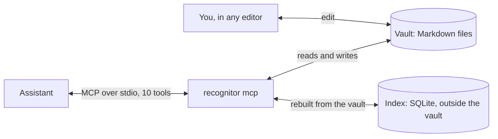
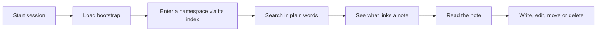
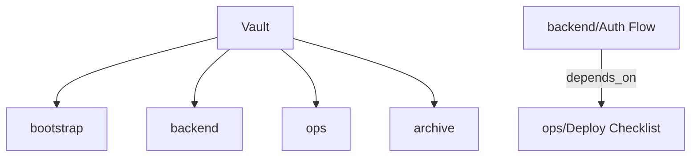
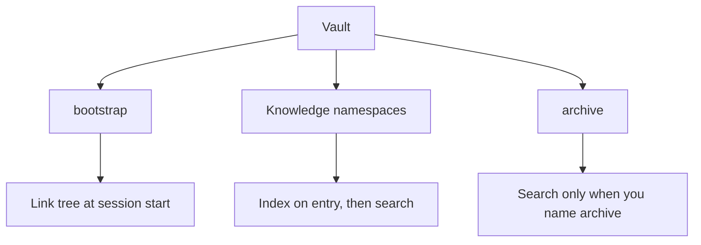
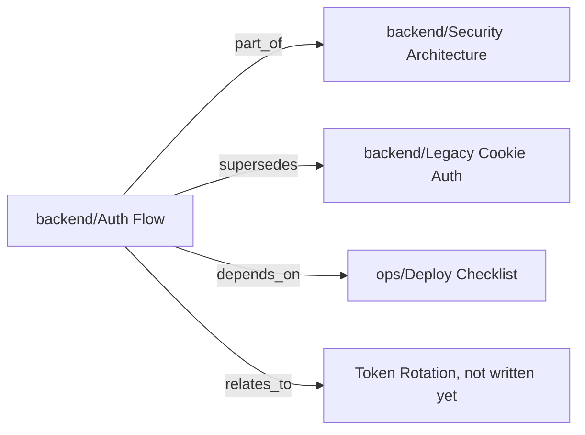
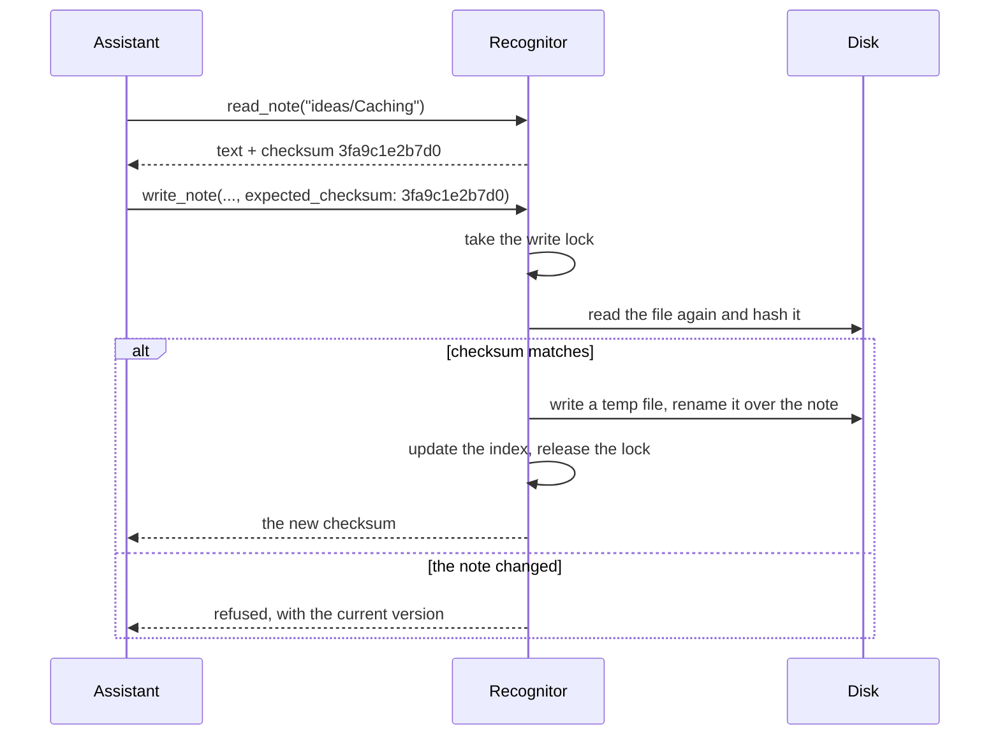
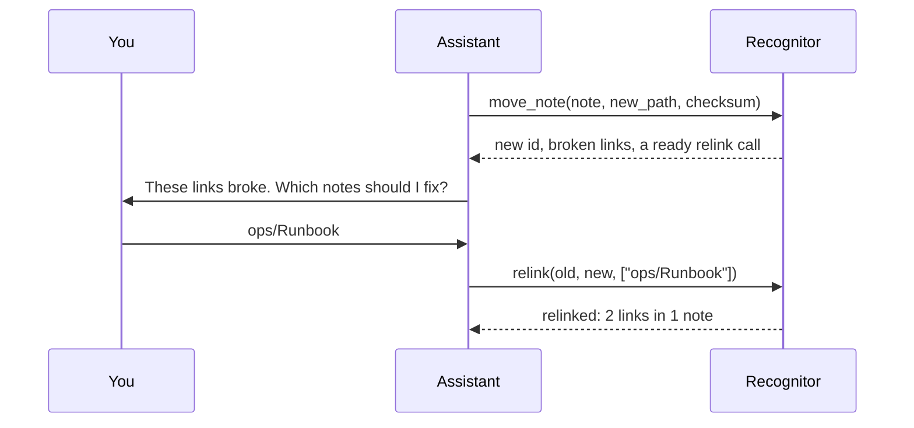

# Recognitor

Recognitor is a local memory for an assistant. You keep ordinary Markdown notes. The assistant loads a short set of instructions at the start of a session, searches the rest, follows links, and writes notes back.

The files on disk are the memory. You open them in any editor. Beside them sits an index that makes search and “what links here” fast. Delete the index and rebuild it; the notes stay.

Work, personal, and research notes share one graph. A work note can link a personal note, and a walk follows that link.



## How a session works



1. **Bootstrap.** At the start, Recognitor loads the notes linked from `bootstrap/index.md`: who you are, how to talk to you, rules that apply everywhere.
2. **Enter a namespace.** A namespace is a top-level folder. Opening it means reading that folder’s `index.md`. The folder is a doorway and a point of view. Search can still find notes in other namespaces.
3. **Search.** Ask in plain words. Notes in the current namespace, and notes it links, rank higher. Other knowledge namespaces can still appear.
4. **Context, then read.** Context returns the short form of a note and the links around it. Read fetches the body. A long note is cut to its best sections, and any section can be read on its own.
5. **Write.** The assistant creates, edits, moves, or deletes notes. Each change checks that the note is still the version the assistant read.

Search and context stay short on purpose. The assistant sees a title, a one-paragraph summary, and a few matching lines, then asks for the full note only when it needs it.

## Namespaces

A namespace is the top-level folder under the vault. `work/auth/Login.md` belongs to `work`. The folder `auth` is only a folder. Files sitting directly in the vault root are left out of the index.

`bootstrap` and `archive` are reserved namespaces. Every other top-level folder is a knowledge namespace: `work`, `personal`, `research`.



The index keeps no “current namespace.” Each search carries the name, and that name only changes ranking. Notes in it, and notes linked from it, come first. A link still resolves across namespaces, and a walk follows it.

Each namespace has an `index.md` at its top. That file is the entry point: the assistant reads it once, then searches with the namespace name. A folder can exist without an index; its notes are still stored, and only the entry point is missing.

A note’s address is its path from the vault root, without `.md`: `backend/Auth Flow`. Case does not change the name, so `Auth Flow.md` and `auth flow.md` are one note. When both files exist, sync skips them and names them in the report.

## Three stores

The store is the namespace. Location decides how a note is loaded. A `type` line in frontmatter is only a label.



**Bootstrap** holds instructions. Loading starts at `bootstrap/index.md` and follows two relation words, `indexes` and `has_part`, in the order they are written. Each reached note is loaded, then its downward links are followed the same way. A `relates_to` link, a mention in prose, or a link that leaves the folder stays a reference and is left out of the payload. A file in `bootstrap/` that no such link reaches stays on disk. That is how you keep several personas and load one of them: change the link.

**Knowledge** is everything else. The namespace index comes in when you enter. Other notes wait until a search or a walk asks for them. Walks stay inside knowledge. They do not enter the bootstrap.

**Archive** holds raw session records. A search includes it only when you name `archive`. The text is indexed. Observations and links inside archive notes are ignored, so a transcript does not fill the graph with stray facts and missing targets.

What each kind of tool may do in each store:

| | bootstrap | knowledge | archive |
| :--- | :--- | :--- | :--- |
| **Search** | Never | Yes | Only when you name `archive` |
| **Context** | Never listed | Yes | Listed, marked `(archive)` |
| **Read** | Yes | Yes | Yes |
| **Write** | Yes, and the answer says the note loads at every session start | Yes | Create and append only: never changed, moved or deleted by a tool |

## Notes, observations, and links

A note is a Markdown file. The index lifts four things out of it.

- **Title.** The heading, or a title in the frontmatter.
- **Summary.** The first paragraph after the heading, kept short. Search and context show this instead of the whole file.
- **Observations.** A list item that starts with a bracketed word, such as `- [decision] Refresh tokens are rotated on every exchange`. The word is a category you choose. Each observation is stored on its own, so a search can show the matching line under the note.
- **Links.** Typed links live under a `## Relations` heading: `part_of [[Decisions]]`. A link written in the prose, or a normal Markdown link to another note, is stored as a plain “links to.”

```markdown
---
title: Auth Flow
type: spec
tags: [security, oauth]
---

# Auth Flow

Handles OAuth2 token refresh and session rotation across backend services.

## Observations

- [fact] Access tokens expire after 15 minutes.
- [decision] @effective:2026-06-10 Refresh tokens are rotated on every exchange.

## Relations

- part_of [[Security Architecture]]
- supersedes [[Legacy Cookie Auth]]
- depends_on [[ops::Deploy Checklist]]
- relates_to [[Token Rotation]]
```

`part_of` places the flow inside the security architecture. `supersedes` records that it replaced cookie auth. `depends_on` points at the ops checklist you follow before a release, and the `ops::` prefix names that other namespace. `relates_to [[Token Rotation]]` names the note for the rotation rule. Until that file exists, the link stays a ghost. You write each link in one direction. The index answers the other direction, so the target note can list who points at it. A few relation words have a job: `part_of` and `has_part` describe a tree, `indexes` marks a note the bootstrap should load, and `supersedes` marks an older note as history. Any other word, such as `depends_on`, is a free association.

A wikilink finds its target in this order: the full path, then `namespace::Name`, then the same name inside the linking note’s namespace, then a name that exists in only one namespace. If nothing matches, or two notes share the name, the link is kept with an empty target. That missing note is a **ghost**. When the note is written later, by a tool or by hand, the target fills in. Deleting the note turns the link back into a ghost.



Frontmatter holds labels such as title, type, and tags. Links go in the body and under Relations, so a typo in the header cannot move a note into the bootstrap or out of search.

## The index

Sync walks the vault and compares each file’s modification time and size with what the index stored. It reads a file again only when those differ, or when the file is new or gone. For about two seconds after a sync, the next lookup skips the walk and uses the index as it stands, so a burst of searches does not stat the whole tree each time. An edit made in that window shows up on the sync after it.

`rebuild` drops the index and reads every note again. The index lives outside the vault, one file per vault, so it never sits among the notes you edit or commit.

## Writing notes

The assistant writes through five tools. None of them overwrites work it has not seen.

| Tool | What it does | Refused when |
| :--- | :--- | :--- |
| `write_note` | Creates a note, or replaces a whole note | Create: a note with that name exists. Replace: the note changed since it was read |
| `edit_note` | Changes part of a note: `append`, `add_observation`, `add_relation`, `find_replace`, `replace_section` | `find_replace`: the text no longer occurs exactly once. `replace_section`: the section changed |
| `move_note` | Moves or renames a note, and lists the links the move broke | The note changed, or the new path is taken |
| `relink` | Rewrites the links to a moved note, in the notes you pick | Never: a link someone already fixed is skipped with a warning |
| `delete_note` | Moves a note to the vault trash, and lists the links that now point nowhere | The note changed |

**Checksums.** `read_note` shows a short checksum with every note. A replace, a move, or a delete passes it back. If the file changed in between, through another agent or through you in an editor, nothing is written. The refusal carries the current version, so the assistant can retry without another read.



**One writer at a time.** Writes queue on SQLite's write lock, so several agents and the CLI can share one vault. Reads never wait for a write.

**Long notes.** A note over the read limit (4,000 tokens by default) is cut to its best sections. The assistant can still move or delete it, but it cannot replace it whole, because it has seen only part of it. It edits such a note one section at a time.

**Trash.** `delete_note` moves the file to `.recognitor/trash/<UTC time>/<original path>`. To undo a delete, move the file back. The trash is a hidden folder, so the index never sees it.

## Moving a note

A tool call cannot stop halfway to ask you something, so a move takes two calls, with you in between.



What `move_note` returns:

```
moved: ideas/Caching -> design/b/Caching
broken links: 3 links in 2 notes
- design/b/Caching: links_to ./Setup
- ops/Runbook, titled "Runbook v2": links_to ideas::Caching
- ops/Runbook, titled "Runbook v2": relates_to ../ideas/Caching
relink(old: "ideas/Caching", new: "design/b/Caching", notes: ["ops/Runbook"])
```

- **Links by name usually survive.** `[[Caching]]` keeps working unless the move makes the name match two notes. Paths and `namespace::` prefixes break.
- **Links inside the moved note** (the first line above) are fixed with `edit_note`, because `relink` only rewrites links that point to the moved note.
- **`relink` writes each new link in the shortest form** that still reaches the note from the linking note.
- **A move made in an editor or a file manager** looks like a delete plus a create, so its broken links become ghosts. `recognitor relink` fixes them once you know the old id.

## Tools

**For the assistant, over MCP:**

| Tool | Use |
| :--- | :--- |
| `load_bootstrap` | Standing instructions, once at session start, unless a hook already loaded them |
| `load_namespace` | A namespace's entry note, once when work enters it |
| `search` | Full-text search, 5 hits per page, with summaries and matching facts |
| `context` | A note's links out and in, with summaries |
| `read_note` | A note's text and checksum, or one section |
| `write_note`, `edit_note`, `move_note`, `relink`, `delete_note` | Writes, as above |

**For you, on the command line:**

| Command | Does | State |
| :--- | :--- | :--- |
| `sync`, `rebuild` | Update the index, or build it again from scratch | ✅ |
| `search`, `context`, `read`, `bootstrap [--list]` | Show exactly what the assistant sees | ✅ |
| `relink` | Fix links after a move made outside Recognitor | ✅ |
| `mcp` | Serve the tools to one assistant session over stdio | ✅ |
| `config get/set` | Read and change the config file | ✅ |
| `move` | Move a note and pick the links to fix, in one command | ⏳ designed |
| `ghosts` | List links to missing notes, with a hint where a moved note went | ⏳ designed |
| `trash empty` | Clear `.recognitor/trash` | ⏳ designed |
| `lint` | Report case twins, missing entry points, and other problems | ⏳ designed |

## Setup

1. **Build and install** the binary:

   ```bash
   cargo install --path .
   ```

2. **Point it at your vault.** Recognitor looks for `--vault`, then the `RECOGNITOR_VAULT` environment variable, then `vault.path` in its config file. It never guesses from the current folder. Set it once:

   ```bash
   recognitor config set vault.path /path/to/vault
   recognitor sync
   ```

3. **Connect the assistant.** For Claude Code:

   ```bash
   claude mcp add recognitor -- recognitor mcp
   ```

4. **Load the bootstrap at session start.** A hook is the reliable way, because it does not depend on the model following an instruction. In Claude Code's `settings.json`:

   ```json
   {
     "hooks": {
       "SessionStart": [
         { "hooks": [{ "type": "command", "command": "recognitor bootstrap" }] }
       ]
     }
   }
   ```

   Without hooks, tell the assistant in its instruction file: "Session start: call `load_bootstrap()`, then `load_namespace('<project>')`."

On Windows, a running server keeps the binary open. Disconnect it first (`/mcp` in Claude Code), then reinstall.

The CLI shows the same text the assistant gets:

```bash
recognitor search "auth tokens" --ns backend
recognitor context "Auth Flow"
recognitor read "Auth Flow" --section "Observations"
recognitor bootstrap --list
recognitor relink ideas/Caching design/b/Caching ops/Runbook
```

`sync --report` prints extra detail for checking the index. Everyday use can skip it.

## Status

| Area | State |
| :--- | :--- |
| Read tools and the MCP server | ✅ Built and tested |
| Write tools | ✅ Built and tested |
| CLI `move`, `ghosts`, `trash empty`, `lint` | ⏳ Designed, not built |
| Search ranking | ⚠️ The namespace boost uses placeholder values until the retrieval benchmark sets them |
| Vector search | ⏳ Planned |
| Platforms | Developed and tested on Windows. Linux and macOS are untested |

## Further reading

- [Architecture Overview](docs/01-architecture-overview.md): vision, storage model, and how Recognitor differs from Basic Memory.
- [Open Questions & Tradeoffs](docs/02-open-questions-and-tradeoffs.md): design decisions, rejected alternatives, and scale targets.
- [Markdown Format & Edge Syntax](docs/03-markdown-format-and-edge-syntax.md): note layout, observations, relations, and link resolution.
- [Information Stores & Lifecycle](docs/04-information-stores-and-lifecycle.md): bootstrap, knowledge namespaces, archive, and session loading.
- [Database Schema](docs/05-database-schema-specification.md): tables, indexes, query patterns, and where the index file lives.
- [Design Reviews](docs/06-design-reviews.md): review log and finding tracker.
- [Interface Contracts](docs/07-interface-contracts.md): every tool and CLI command as specified, including ones not built yet.
